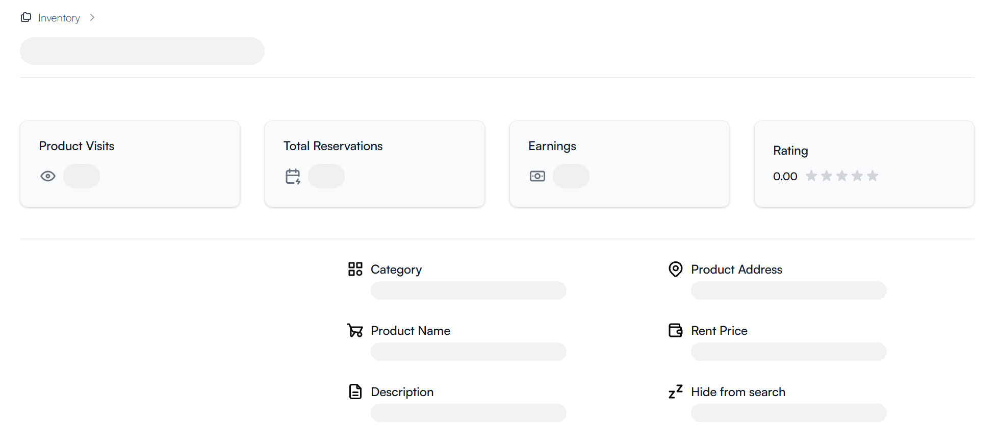
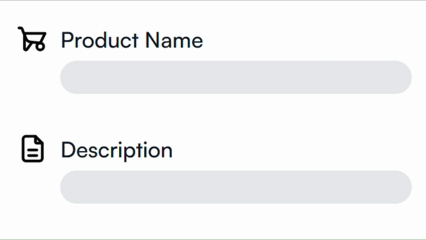

# next-suspend

The `suspend` utility runs your [query through `React.cache`](https://nextjs.org/docs/app/getting-started/fetching-data#reusing-data-with-reactcache) using your Next.js page `params` as the cache keys.
It returns an enhanced [`<Suspense>` component, which awaits the `params` ](https://nextjs.org/docs/app/getting-started/caching#maximizing-the-static-shell) and renders the resolved value through a children prop.

```
npm i next-suspend
```

<a aria-label="NPM version" href="https://www.npmjs.com/package/next-suspend">
  
</a>

## Motivation

The `suspend` utility makes it easy to build layouts where it appears that individual values are suspended, but in practice only one entity is awaited:



### Maximize the static shell & minimize the loading skeleton

The layout above could use one `<Suspense>` with a huge SkeletonLayout
as the fallback, where we would reuse the grid, cards and property components.

The `suspend()` utility enables us to **minimize the skeleton size** by using multiple `<Suspend>` components - one for each object property.

This alleviates the need to reuse the labels, cards or grid elements in the fallback, which makes it easier to **achieve zero layout shift** during the suspense transition.

## Usage

```tsx
import { suspend } from "next-suspend";

// 1. Setup your data query:
const { Suspend: Product } = suspend(
  async ({ productId }: { productId: string }) => {
    const product = await db.select.productById({ productId });
    if (!product) {
      notFound();
    }
    return product;
  },
  { fallback: <SkeletonLine /> },
);

// 2. Pass the params & render values suspensefully:
export default function Page({ params }: PageProps<"/market/[productId]">) {
  return (
    <>
      <Property icon={<TbGardenCart />}>
        <PropertyTitle>Product</PropertyTitle>
        <PropertyValue>
          <Product params={params}>{({ name }) => <span>{name}</span>}</Product>
        </PropertyValue>
      </Property>
      <Property icon={<TbFileDescription />}>
        <PropertyTitle>Description</PropertyTitle>
        <PropertyValue>
          <Product params={params}>
            {({ description }) => <span>{description}</span>}
          </Product>
        </PropertyValue>
      </Property>
    </>
  );
}
```

Your query will run once per params. The page can now render the titles (Product & Description) into a static shell for an instant navigation:



## `withSuspend` higher-order component

Reduce the boilerplate of passing the `params` prop. The `withSuspend()` utility passes both the `params` and the `searchParams`
to your `<Suspend />` component, which you receive in your Page props:

```tsx
import { suspend, withSuspend, type PageSuspend } from "next-suspend";

type Params = Awaited<PageProps<"/market/[productId]">["params"]>;

// 1. Setup your data query:
const { Suspend } = suspend(
  async ({ productId }: Params) => {
    const product = await db.select.productById({ productId });
    if (!product) {
      notFound();
    }
    return product;
  },
  { fallback: <SkeletonLine /> },
);

// 2. Define page receiving the `Suspend` component via props:
function Page({ Suspend: Product }: PageSuspend<typeof Suspend>) {
  return (
    <>
      <Property icon={<TbGardenCart />}>
        <PropertyTitle>Product</PropertyTitle>
        <PropertyValue>
          <Product>{({ name }) => <span>{name}</span>}</Product>
        </PropertyValue>
      </Property>
      <Property icon={<TbFileDescription />}>
        <PropertyTitle>Description</PropertyTitle>
        <PropertyValue>
          <Product>{({ description }) => <span>{description}</span>}</Product>
        </PropertyValue>
      </Property>
    </>
  );
}

// 3. Export the page
export default withSuspend({ Suspend })(Page);
```

## Usage w/ client components

Your suspend query [can be streamed to the client](https://nextjs.org/docs/app/guides/single-page-applications#using-reacts-use-within-a-context-provider) with the `useSuspend()` hook consuming a promise from a context provider:

```tsx
// app/market/[productId]/product.ts
import { suspend } from "next-suspend";

const { queryCache, Provider } = suspend(
  async ({ productId }: { productId: string }) => {
    // query the product
  },
);

// 1. export the Provider and the result type:
export const ProductProvider = Provider;
export type Product = Awaited<ReturnType<typeof queryCache>>;
```

```tsx
// app/market/[productId]/layout.tsx
import { ProductProvider } from "./product";

// 2. Use the Provider in the layout:
export default function ProductLayout({
  params,
  children,
}: LayoutProps<"/market/[productId]">) {
  return <ProductProvider params={params}>{children}</ProductProvider>;
}
```

```tsx
// app/market/[productId]/components.tsx
import { useSuspend } from "next-suspend/client";
import type { Product } from "./product";

// 3. Type the context value:
export function useProduct() {
  return useSuspend() as Product;
}
```

```tsx
// app/market/[productId]/components.tsx
"use client";

// 4. Consume the hook in your client components:
function Name() {
  const product = useProduct();
  return <span>{product.name}</span>;
}

export function ProductName() {
  return (
    <Suspense fallback={<SkeletonLine />}>
      <Name />
    </Suspense>
  );
}
```

```tsx
// app/market/[productId]/page.tsx
import { ProductName } from "./components";
import { ProductDescription } from "./components";

// 5. Finally render the components on a page:
export default function ProductPage() {
  return (
    <>
      <Property icon={<TbGardenCart />}>
        <PropertyTitle>Product</PropertyTitle>
        <PropertyValue>
          <ProductName />
        </PropertyValue>
      </Property>
      <Property icon={<TbFileDescription />}>
        <PropertyTitle>Description</PropertyTitle>
        <PropertyValue>
          <ProductDescription />
        </PropertyValue>
      </Property>
    </>
  );
}
```

## Helper types

Simplify the data resolvers, so their params are typed by your routes:

```ts
// 1. Define a global helper type
import type { AppRoutes } from "@/../.next/types/routes";

declare global {
  type SuspendParams<Route extends AppRoutes> = Awaited<
    PageProps<Route>["params"]
  >;
}

// 2. Get params by a route:
const { Suspend: Product } = suspend(
  async ({ productId }: SuspendParams<"/market/[productId]">) => {
    // ...
  },
);
```

## Troubleshooting

### My query still runs twice

The `queryCache` uses the `params` promise as the key, so you are using two different params. This can happen if you use both layout & page params, which are different promises.

If you use the `<Provider>` in the layout, then stream the data to client with the `useSuspend()` and don't use the `<Suspend>` in your page.

Note that both the `<Provider>` and the `<Suspend>` server components can be used in both page & layout, so if you are static shell maxxing your page with the `<Suspend>`, also render the `<Provider>` in your page (if needed) so they share the same `params`.
